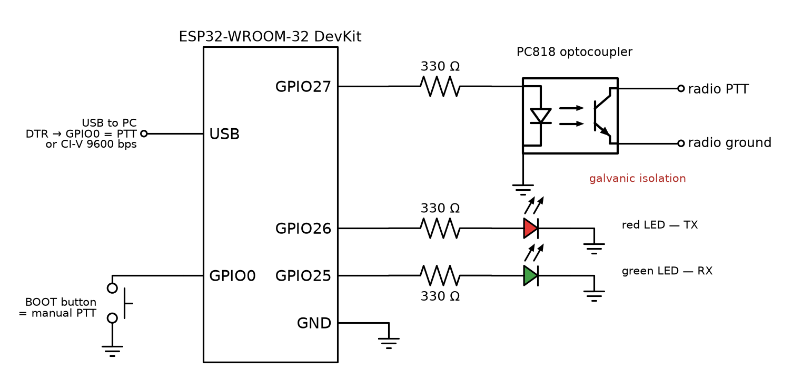
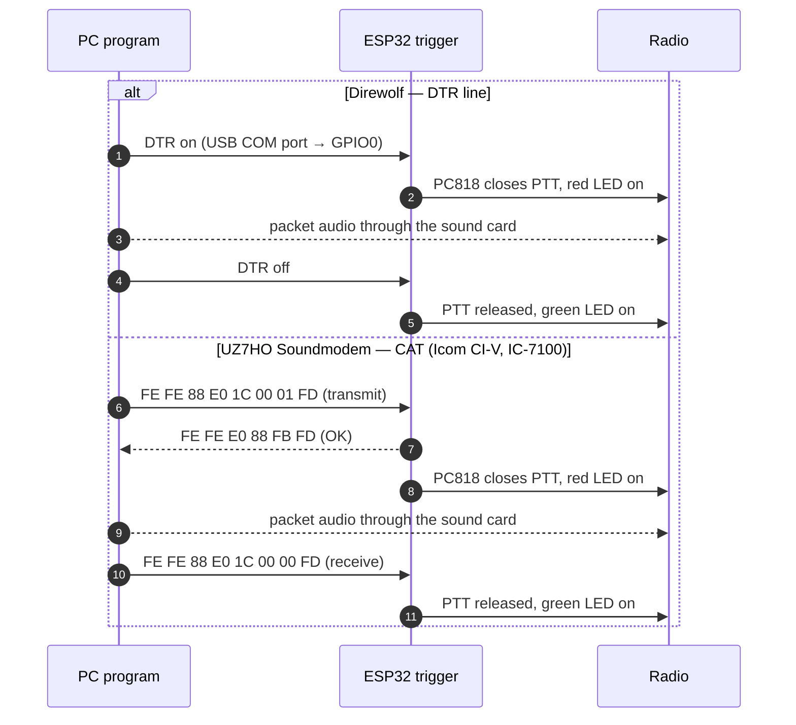
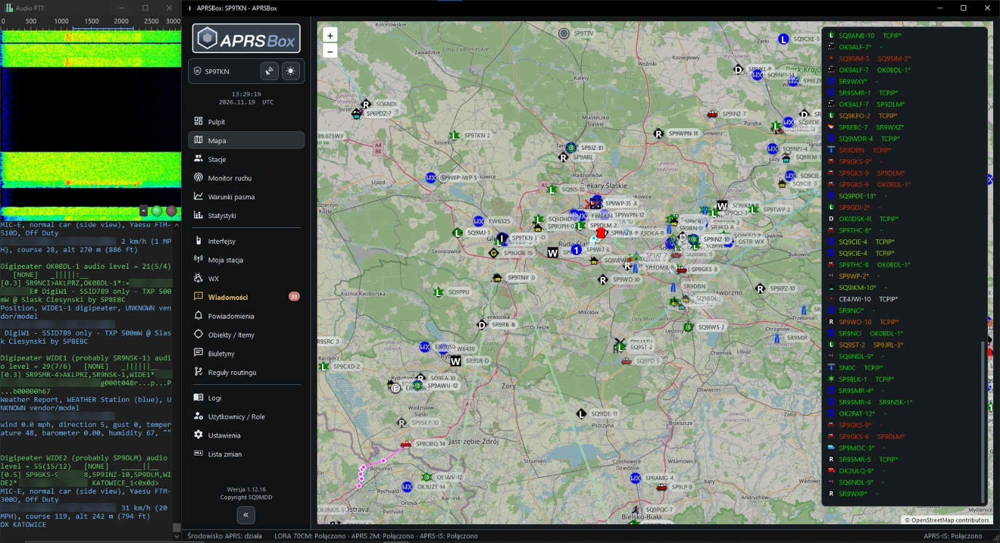
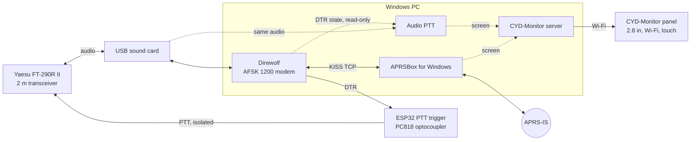

# ESP32 PTT trigger with PC818 optocoupler (Icom CI-V emulation)

> 🇵🇱 Polish version: [README.pl.md](README.pl.md)

<!-- ecosystem-link:aprs -->
📡 Part of the **SP9TKN APRS station** — see [how the pieces work together](#part-of-the-sp9tkn-aprs-station).

A tiny USB PTT interface for digital modes (APRS, packet, FT8 …): an **ESP32-WROOM-32** board keys the radio
through a **PC818 optocoupler** (galvanic isolation), with a green RX LED and a red TX LED. The PC controls it
over USB by **emulating the Icom CI-V protocol of the IC-7100** (address 0x88, 9600 bps), so any program with
CAT PTT for the IC-7100 works. The BOOT button keys PTT manually (press and hold) for testing without a PC.

## Wiring

| ESP32 | Part | Note |
|---|---|---|
| GPIO27 | 330 Ω → PC818 pin 1 (anode); pin 2 (cathode) → GND | PTT output |
| — | PC818 pin 4 (collector) → radio PTT, pin 3 (emitter) → radio ground | radio side, isolated |
| GPIO25 | 330 Ω → green LED → GND | RX (listening) |
| GPIO26 | 330 Ω → red LED → GND | TX (transmitting) |
| GPIO0 (BOOT) | on-board button | manual PTT, active low |

The device always starts in RX (PTT off). Pins and CI-V settings are in [`src/config.h`](src/config.h).

## CI-V emulation

The firmware answers the commands needed for PTT: read frequency (`03`), read mode (`04`) and the
transceive / PTT command `1C 00 01` / `1C 00 00` with an OK reply (`FB`). It reports a fixed frequency
(14.074 MHz USB) so that programs which poll the radio are satisfied.

## How keying works

On the DTR path the firmware sees the line through GPIO0 exactly like a pressed BOOT button (25 ms debounce),
so the radio keys within a few tens of milliseconds — far below Direwolf's default TXDELAY.

## Program settings (tested)

- **UZ7HO Soundmodem 1.14** — CAT PTT, `Radio=2` in `ptt.ini` (= IC-7100, address 0x88), 9600 bps — works
  reliably. COM PTT with "Swap COM pins" (DTR) also works; COM PTT on RTS resets the board.
- **Direwolf 1.7 / 1.8 (Windows, no hamlib CAT)** — use `PTT COMx DTR`. On ESP32 dev boards the auto-reset circuit
  connects RTS to EN (reset) and DTR to GPIO0, which the firmware treats as the BOOT button = TX.
  Run `mode COMx dtr=off rts=off` before starting Direwolf — the CH340 driver remembers line states from the
  previous session, and a left-over RTS keeps the ESP32 in reset. Never use `PTT COMx RTS` (reset) or
  `-DTR` (continuous transmit).

## T-Display variant

  
  

The same trigger also runs on a **LilyGO (TTGO) T-Display**: an ESP32 with a 1.14" ST7789 screen (240×135). Instead
of two LEDs, the whole screen turns **green with RX** or **red with TX**, so you can read it from across the room. The
images above were rendered from the firmware's own drawing code and the TFT_eSPI font data, pixel for pixel (shown ×2).

| T-Display | Function |
|---|---|
| GPIO27 | 330 Ω → PC817 optocoupler → radio PTT |
| GPIO0 (BOOT button) | manual PTT (press and hold) |
| GPIO35 (second button) | backlight: 7 steps from full to off, kept in flash |

The CI-V emulation is the same as on the DevKit (IC-7100, address 0x88, 9600 bps). GPIO0 is read exactly as on the
DevKit and the board has the same auto-reset circuit, so the DTR path should work the same way.

The source is in [`t-display/`](t-display). It is built on [pioarduino](https://github.com/pioarduino/platform-espressif32)
(Arduino ESP32 3.3.8), pinned in its `platformio.ini`: `cd t-display`, then `pio run -t upload --upload-port COMx`.
Run PlatformIO from PowerShell or VS Code, because pioarduino refuses to build in Git Bash / MSYS shells.

<!-- ecosystem:aprs:start -->

## Part of the SP9TKN APRS station

Five projects work together as one APRS station on a Windows PC with a Yaesu FT-290R II (2 m). Each part does one job and also works on its own.

| Project | Role |
|---|---|
| [ESP32 PTT trigger](https://github.com/SP9TKN/esp32-ptt-pc818) **← you are here** | keys the radio's PTT through a PC818 optocoupler (galvanic isolation), red/green TX/RX LEDs |
| [Audio PTT](https://github.com/SP9TKN/audio-ptt) | radio audio as a UZ7HO-style waterfall + PTT lamps, read-only |
| [APRSBox for Windows](https://github.com/SP9TKN/APRSBox) | the APRS application: iGate, digipeater, beacons, messages, map (Windows port of SQ9MDD's APRSBox) |
| [CYD-Monitor](https://github.com/SP9TKN/cyd-monitor) | 2.8" ESP32 display as a wireless monitor: the station screen over Wi-Fi, with touch |
| [Direwolf — SP9TKN package](https://github.com/SP9TKN/direwolf) | sound-card modem / TNC (AFSK 1200): WB2OSZ's Direwolf 1.8.1 with a dark console window and the station configuration (PTT on DTR, KISS TCP for APRSBox) |

*The station at work: Audio PTT (top left), Direwolf (bottom left) and APRSBox with the map. Coordinates of other stations in the Direwolf window are blurred.*

**How it works**

1. **Receive.** Audio from the FT-290R II goes through a USB sound card to **Direwolf**, which decodes the AFSK 1200
   packets and hands them to **APRSBox** over KISS TCP. APRSBox stores them, draws them on the map, gates them to
   APRS-IS and digipeats them according to its routing rules.
2. **Transmit.** APRSBox queues a beacon, a message or a frame to digipeat and passes it to Direwolf over KISS.
   Direwolf raises **DTR** on the USB serial port of the **ESP32 PTT trigger** (`PTT COMx DTR`); the board closes the
   radio's PTT through the PC818 optocoupler and lights the red LED, and Direwolf plays the packet audio.
3. **Watch.** **Audio PTT** shows the same radio audio as a waterfall, with two lamps that follow the PTT line. It
   reads the DTR state from the port Direwolf holds, without opening the port, so it never gets in the way of
   transmitting.
4. **From any room.** **CYD-Monitor** mirrors the station desktop (APRSBox map, Audio PTT, Direwolf log) to a 2.8"
   ESP32 "Cheap Yellow Display" over Wi-Fi. The same panel is also the display of the
   [SP9TKN SDR scanner](https://github.com/SP9TKN/cyd-monitor#part-of-the-sp9tkn-sdr-scanner): it jumps to the scanner page when SDR Oxide hears something.
5. **Unattended.** Watchdog scripts (in the APRSBox repository) restart any program that stops and put the windows
   back in place after the monitor sleeps; a virtual display keeps the desktop at 1920×1080 while the physical
   monitor is off.

<!-- ecosystem:aprs:end -->

## Building

[PlatformIO](https://platformio.org/): `pio run -t upload --upload-port COMx`. Ready images are in
**[Releases](../../releases)** — write them at address **0x0**:
`python -m esptool --port COMx write_flash 0x0 <file>.bin` (`esp32-ptt-pc818_…` for the DevKit,
`esp32-ptt-t-display_…` for the [T-Display](#t-display-variant)).

## License

[GPL-3.0](LICENSE) © 2026 SP9TKN.

**Tools:** developed with [Claude Code](https://claude.com/claude-code) (Anthropic) — AI assistant used for
coding, testing and documentation.
