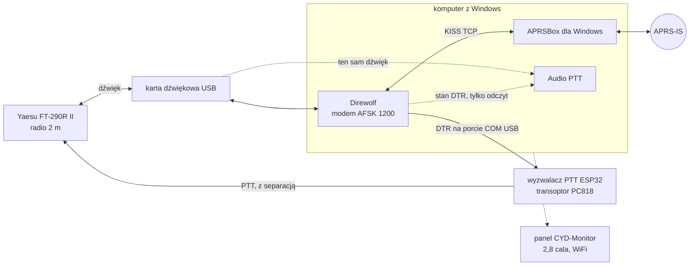

# Wyzwalacz PTT na ESP32 z transoptorem PC818 (emulacja Icom CI-V)

> 🇬🇧 English version: [README.md](README.md)

<!-- ecosystem-link:aprs -->
📡 Część **stacji APRS SP9TKN** — zobacz, [jak elementy działają razem](#część-stacji-aprs-sp9tkn).

Mały interfejs PTT na USB do emisji cyfrowych (APRS, packet, FT8 …): płytka **ESP32-WROOM-32** kluczuje radio
przez **transoptor PC818** (separacja galwaniczna), z zieloną diodą RX i czerwoną TX. Komputer steruje nim przez
USB, **emulując protokół Icom CI-V radia IC-7100** (adres 0x88, 9600 bit/s) — działa każdy program z PTT przez
CAT dla IC-7100. Przycisk BOOT kluczuje PTT ręcznie (wciśnij i trzymaj) — test bez komputera.

## Połączenia

| ESP32 | Element | Uwagi |
|---|---|---|
| GPIO27 | 330 Ω → PC818 pin 1 (anoda); pin 2 (katoda) → GND | wyjście PTT |
| — | PC818 pin 4 (kolektor) → PTT radia, pin 3 (emiter) → masa radia | strona radia, odseparowana |
| GPIO25 | 330 Ω → zielona dioda → GND | RX (nasłuch) |
| GPIO26 | 330 Ω → czerwona dioda → GND | TX (nadawanie) |
| GPIO0 (BOOT) | przycisk na płytce | ręczne PTT, aktywny stan niski |

Urządzenie zawsze startuje w RX (PTT wyłączone). Piny i ustawienia CI-V: [`src/config.h`](src/config.h).

## Emulacja CI-V

Firmware odpowiada na polecenia potrzebne do PTT: odczyt częstotliwości (`03`), odczyt trybu (`04`)
i PTT `1C 00 01` / `1C 00 00` z potwierdzeniem OK (`FB`). Raportuje stałą częstotliwość (14,074 MHz USB),
żeby programy odpytujące radio były zadowolone.

## Ustawienia programów (sprawdzone)

- **UZ7HO Soundmodem 1.14** — PTT przez CAT, `Radio=2` w `ptt.ini` (= IC-7100, adres 0x88), 9600 bit/s — działa
  pewnie. PTT przez COM z „Swap COM pins” (DTR) też działa; PTT przez COM na RTS resetuje płytkę.
- **Direwolf 1.7 / 1.8 (Windows, bez CAT hamlib)** — `PTT COMx DTR`. Na płytkach ESP32 devkit układ auto-resetu łączy
  RTS z EN (reset), a DTR z GPIO0, który firmware traktuje jak wciśnięty BOOT = TX.
  Przed startem Direwolfa uruchom `mode COMx dtr=off rts=off` — sterownik CH340 pamięta stan linii z poprzedniej
  sesji portu, a pozostawiony RTS trzyma ESP32 w resecie. Nigdy `PTT COMx RTS` (reset) ani `-DTR` (ciągłe nadawanie).

<!-- ecosystem:aprs:start -->

## Część stacji APRS SP9TKN

Cztery projekty działają razem jako jedna stacja APRS na komputerze z Windows i radiu Yaesu FT-290R II (2 m). Każda część robi jedną rzecz i działa też osobno.

| Projekt | Rola |
|---|---|
| [Wyzwalacz PTT ESP32](https://github.com/SP9TKN/esp32-ptt-pc818) **← to repozytorium** | kluczuje PTT radia przez transoptor PC818 (separacja galwaniczna), diody TX/RX |
| [Audio PTT](https://github.com/SP9TKN/audio-ptt) | dźwięk z radia jako wodospad jak w UZ7HO + lampki PTT, tylko odczyt |
| [APRSBox dla Windows](https://github.com/SP9TKN/APRSBox) | program APRS: iGate, digipeater, beacony, wiadomości, mapa (port APRSBox SQ9MDD na Windows) |
| [CYD-Monitor](https://github.com/SP9TKN/cyd-monitor) | wyświetlacz ESP32 2,8" jako monitor bezprzewodowy: ekran stacji przez WiFi, z dotykiem |
| [Direwolf](https://github.com/wb2osz/direwolf) (WB2OSZ) | modem / TNC na karcie dźwiękowej (AFSK 1200), bez zmian |

**Jak to działa**

1. **Odbiór.** Dźwięk z FT-290R II idzie przez kartę dźwiękową USB do **Direwolfa**, który dekoduje pakiety AFSK 1200
   i przekazuje je do **APRSBox** przez KISS TCP. APRSBox zapisuje je, rysuje na mapie, wysyła do APRS-IS (iGate)
   i powtarza według reguł digipeatera.
2. **Nadawanie.** APRSBox kolejkuje beacon, wiadomość albo ramkę do powtórzenia i przekazuje ją Direwolfowi przez KISS.
   Direwolf podnosi linię **DTR** na porcie szeregowym USB **wyzwalacza PTT ESP32** (`PTT COMx DTR`); płytka zwiera
   PTT radia przez transoptor PC818 i zapala czerwoną diodę, a Direwolf odtwarza dźwięk pakietu.
3. **Podgląd.** **Audio PTT** pokazuje ten sam dźwięk z radia jako wodospad, z dwiema lampkami, które idą za linią PTT.
   Stan DTR czyta z portu trzymanego przez Direwolfa, bez otwierania portu, więc nigdy nie przeszkadza w nadawaniu.
4. **Z każdego pokoju.** **CYD-Monitor** pokazuje pulpit stacji (mapę APRSBox, Audio PTT, okno Direwolfa)
   na wyświetlaczu ESP32 „Cheap Yellow Display” 2,8" przez WiFi. Ten sam panel jest też wyświetlaczem
   [skanera SDR SP9TKN](https://github.com/SP9TKN/cyd-monitor/blob/main/README.pl.md#część-skanera-sdr-sp9tkn): przeskakuje na stronę skanera, gdy SDR Oxide coś usłyszy.
5. **Bez nadzoru.** Skrypty watchdoga (w repozytorium APRSBox) uruchamiają ponownie program, który się zatrzymał,
   i odstawiają okna na miejsce po uśpieniu monitora; wirtualny ekran trzyma pulpit w 1920×1080, gdy fizyczny
   monitor jest wyłączony.

<!-- ecosystem:aprs:end -->

## Budowanie

[PlatformIO](https://platformio.org/): `pio run -t upload --upload-port COMx`. Gotowy obraz jest w
**[Releases](../../releases)** — wgrywany od adresu **0x0**:
`python -m esptool --port COMx write_flash 0x0 <plik>.bin`.

## Licencja

[GPL-3.0](LICENSE) © 2026 SP9TKN.

**Narzędzia:** program powstał z pomocą [Claude Code](https://claude.com/claude-code) (Anthropic) — asystent AI
do pisania kodu, testów i dokumentacji.
